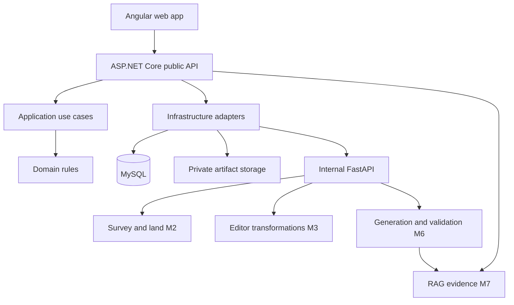

# Runtime and Clean Architecture

Compile-time: Domain has no outward dependency. Application -> Domain. Infrastructure -> Application/Domain as needed. API -> Application/Infrastructure composition root. No cycles. API endpoints translate transport, Application orchestrates use cases, Domain protects invariants, Infrastructure implements ports. Python is not a separate public customer backend. Internal routes protected by network and authenticated service identity. C# owns customer identity, state, transactions and persistence. Computational Python functions operate on explicit snapshots and return structured results, not direct changes to MySQL customer state.

Existing starter layout historically observed: `src/BuildMind.API`, `src/BuildMind.Application`, `src/BuildMind.Domain`, `src/BuildMind.Infrastructure`, `python-services/app`, `rag-service`, `tests`, `docs`. Inspect actual current tree. Do not create duplicate `backend/` wrapper or another FastAPI application. Prefer vertical feature folders under Application and separate endpoint classes. M4 is composition-root/DbContext/migration custodian; proposed M6 Python bootstrap custodian; M7 owns RAG and lead coordination. See [ownership](10-OWNERSHIP.md).

## Implemented composition — BE-M4-D01a (2026-11-17, uncommitted, pending review)
- `BuildMind.sln` (classic format) registers the four `src` projects and `tests/BuildMind.Infrastructure.Tests`.
- `BuildMind.Application.DependencyInjection.AddApplication(IServiceCollection)` and `BuildMind.Infrastructure.DependencyInjection.AddInfrastructure(IServiceCollection, IConfiguration)` are the layer registration entry points; both currently register nothing (no feature handlers, persistence or clients yet).
- `Program.cs` is the only composition root: `AddApplication().AddInfrastructure(configuration)`, `GET /health` (liveness only), `public partial class Program` for test hosting. Readiness is not mapped (BE-M4-D04).
- Packages added: Application → `Microsoft.Extensions.DependencyInjection.Abstractions` 10.0.12; Infrastructure → that plus `Microsoft.Extensions.Configuration.Abstractions` 10.0.12. Domain has no packages or project references.
- Dependency rules are enforced by `LayerDependencyTests` (declared and compiled references, no cycles, only API references Infrastructure). Local execution currently blocked (G17).
